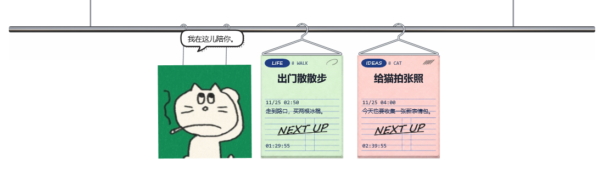
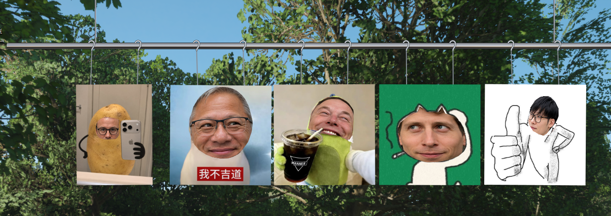
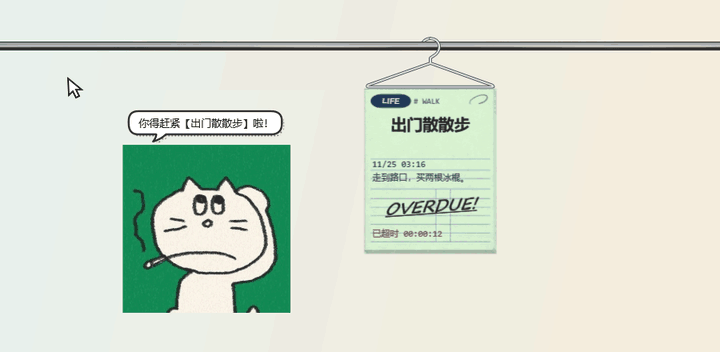
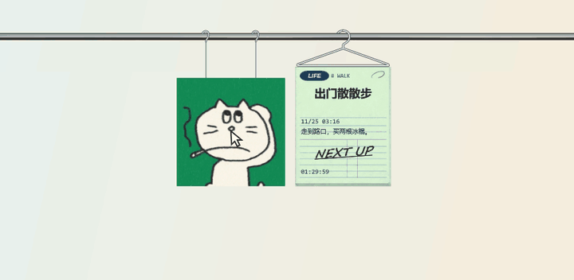

# 晾一晾好朋友

**把好朋友的梗图挂在桌面上。偶尔，也让 TA 催你出门散散步。**

晾一晾是像素无限工作室做的一款 Windows 桌面陪伴小工具（MAC在做了！！！！。挑一张群聊里用到包浆的表情包，挂到晾衣杆上，再给它写两句话。哪怕今天一张便签都没写，打开电脑，也有个好朋友在那儿晃悠。



## 今天想挂谁？

**有一张图就能开张。** 想留住表情包上自带的大字，就把整张原图做成照片卡。想给朋友换个造型，可以把脸贴进棒球衫小人或小猫模板，也可以上传自己画的身体，圈出脸的位置。抠图和修边都在本机完成。挂上几个搭子后，把今天最想见的那位设为主陪，TA 就坐在最左边。



**让它开口像本人。** 平时聊天、快超时、已超时、完成后，各有一本小台词簿。每栏都能写好几句，让搭子随机挑。打开主动聊天，它自己就会冒泡；开口多勤，也由你定。比如给「出门散散步」这件事配上两句：

> 快超时了：「鞋穿好没？楼下等你。」
>
> 做完回来：「哟，今天还真让你晒到太阳了。」

**给今天的小事挂张纸条。** 快到点时，搭子会在杆上晃起来。开启超时追逐后，还拖着不动，刚才那张脸就会一边左右翻转，一边追着你的鼠标跑。做完了，把便签拖进废纸篓，听搭子来一句收尾。想安静一会儿，点挂件上的「安静」就好。



**手闲的时候，拽一下绳子。** 开启「拉绳弹飞」，把搭子往后拉，松手，它会嗖地飞出屏幕，再挂回原位。也可以打开「重拍搭子」，点一下，看它原地转两圈。两种玩法可以一起开。



## 第一次挂上桌面

1. 在 **Windows 10 / 11（64 位）** 上完整解压 Windows 便携版 ZIP，双击 `dist/Clothesline.exe`。旁边的 `web` 文件夹要一起保留。便携版可以离线运行，无需安装 Node.js。
2. 从系统托盘打开「看板」，进入 **陪伴模式 → 我的搭子**。可以先让默认的小猫陪你，也可以换成好友照片，填一句 TA 的口头禅，点「保存并上架」。
3. 想记件事，就点挂件上的 **「＋ 写便签」**。想换个位置，拖动工具栏；想把整个挂件调小一点，按住 Ctrl 滚动鼠标滚轮。

照片、台词和便签保存在这台电脑上。要备份桌面版，退出挂件后复制整个 `%LOCALAPPDATA%\Clothesline` 文件夹，照片素材也在里面。[Windows 完整使用说明](desktop/README.zh-CN.md)

## 从源码运行

开发环境需要 Windows、Node.js 22+ 和 npm。编译挂件用到系统的 .NET Framework 4.x。克隆仓库后，在项目根目录运行：

```powershell
npm ci
npm run desktop:build
npm run desktop:start
```


| 想做什么                    | 命令                      | 到哪里看                                           |
| --------------------------- | ------------------------- | -------------------------------------------------- |
| 边改边看看板                | `npm run dev`             | 浏览器打开`http://localhost:3000`                  |
| 只构建网页                  | `npm run build`           | `out/`                                             |
| 更新 Windows 挂件和配套看板 | `npm run desktop:build`   | `desktop/dist/Clothesline.exe`                     |
| 生成可分发的 Windows ZIP    | `npm run desktop:package` | `releases/` 中带构建时间的 ZIP 和 SHA-256 校验文件 |

浏览器开发预览使用独立的本地存储。要试桌面上的拉绳、追逐和托盘提醒，请启动 Windows 挂件。

<details>
<summary>开发检查与项目结构</summary>

```powershell
npm run lint
npm run typecheck
npm test
```

构建桌面版后，可用 `npm run desktop:test` 检查原生窗口和本机数据接口，用 `node scripts/test-web.mjs` 运行看板交互测试。浏览器测试支持通过 `CHROME_PATH` 指定 Chrome 或 Edge。


| 目录                  | 内容                                   |
| --------------------- | -------------------------------------- |
| `app/`、`components/` | 便签看板、搭子设置和照片编辑器         |
| `lib/`                | 便签、陪伴、提醒与存储逻辑             |
| `desktop/`            | Windows 挂件、托盘、本机服务和打包脚本 |
| `public/`             | 角色、便签纸、离线抠图模型和运行资源   |
| `tests/`、`scripts/`  | 单元测试、交互测试和发行验证           |

</details>

## 像素无限工作室出品

如果是你的好友挂在屏幕上，TA 会用哪句话催你？欢迎在微信公众号、小红书或抖音搜索 **像素无限Pixel Infinity**，把那句话告诉我们，也可以来看看工作室的其他作品。[访问工作室官网](https://xiangsuwuxian.gulu9832.xyz/)
