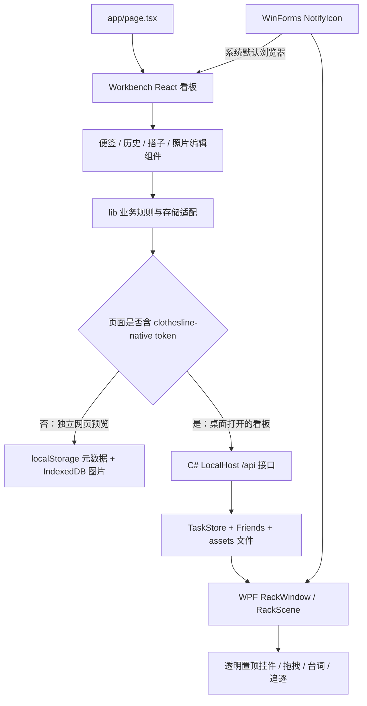
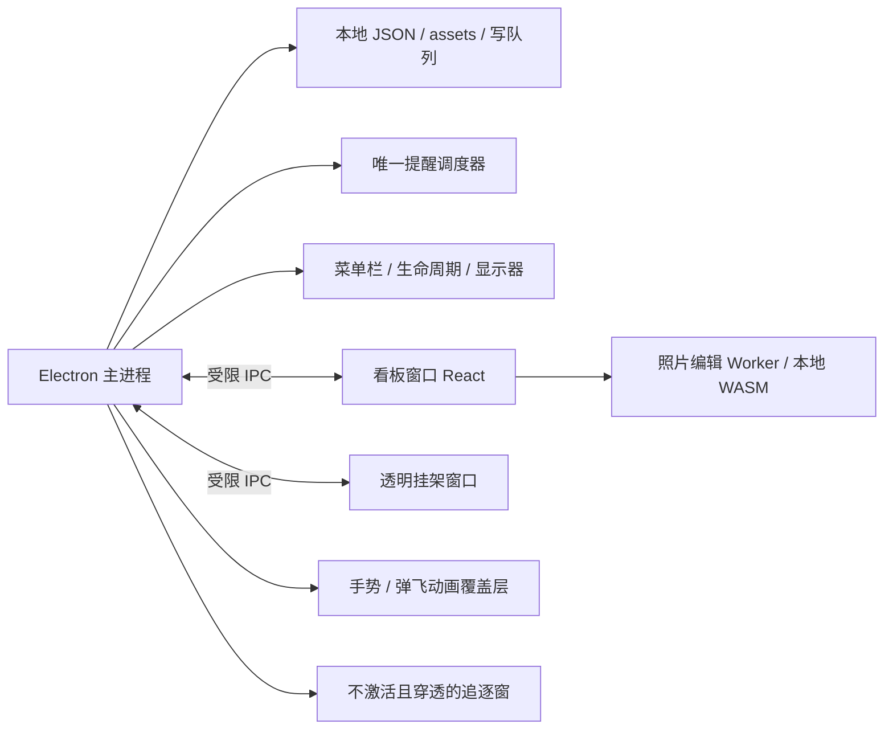

# memo-rack：macOS 桌面应用迁移分析与实施方案

> 审查日期：2026-11-25（Asia/Shanghai）  
> 审查基线：`82a381bb6720802aa45ccadcbd1be59c81750105`，首次提交「晾一晾好朋友 v1.0」  
> 目标设备：Apple Silicon Mac；本机核验环境为 macOS 26.6、arm64、Node.js 26.10.0、npm 11.19.1。  
> 文档状态：待审核。本次仅审查、运行已有基础检查并制定方案，没有实施迁移，没有修改业务源代码。

## 1. 结论与建议

建议采用 **新增 macOS Electron 桌面端 + 复用 Next.js 静态导出、React 组件和 TypeScript 业务规则** 的方案。

- 原项目不是 Electron 应用，而是「React 网页看板 + C# WPF 桌面挂件 + C# 本机 HTTP 服务」。不能通过修改打包目标直接生成 Mac 应用。
- 看板、照片编辑、自定义身体模板、台词编辑、素材和大部分业务规则都可复用。桌面挂件的窗口、跨屏输入、托盘、跨窗口动画和持久化宿主需要新增 macOS 实现。
- macOS 端提供独立看板窗口、透明桌面挂件、只展示动画的覆盖窗口和菜单栏图标。用户安装 `.app` 后可离线使用，不依赖浏览器、Node.js 安装或开发服务器。
- 现有 `desktop/` C# 实现和 Windows PowerShell 命令继续保留。macOS 新宿主放入独立目录，公共代码只增加明确的平台适配入口。
- Electron 是本项目当前约束下的优先选择，不代表它能免除原生适配。必须先验证局部点击穿透、拖出窗口、跨屏弹飞和不抢焦点追逐；若 Electron 窗口 API 无法稳定满足，再局部增加 AppKit 辅助实现。

**本轮不承诺已完成 macOS 桌面兼容。** 已验证的是原有前端在本机能够构建及业务单元测试通过；尚未开发 macOS 窗口，也未运行 Windows 原生版本。首次开发应先交付桌面交互验证结果，再进入完整迁移。

## 2. 审查范围与证据边界

### 2.1 已审查内容

覆盖仓库现有的一方实现与配置：

| 范围 | 内容 |
| --- | --- |
| 说明与配置 | 根目录 `README.md`、`desktop/README.md`、照片测试素材 README、`package.json`、完整锁文件结构与依赖平台声明、Next.js/TypeScript/ESLint/Vitest/PostCSS 配置、`.gitignore` |
| 页面和组件 | `app/` 中的全部 TSX/CSS；`components/` 中全部 11 个组件文件 |
| 共享逻辑 | `lib/` 中全部 8 个 TypeScript 文件 |
| Windows 桌面 | `desktop/` 中全部 7 个 C# 文件、构建与打包脚本 |
| 测试 | 3 个单元测试文件、提醒契约 JSON、全部 8 个交互/集成测试 MJS、2 个 C# 检查程序、2 个 PowerShell 检查脚本 |
| 运行资源 | 自有抠图 Worker、角色与台词 JSON、图片/音效/图标目录、模型与运行时清单、第三方许可；核对角色资源是否存在及模型 SHA-256 |

仓库共有 120 个受版本控制的文件。二进制图片、音频、ONNX/WASM 及第三方压缩运行时按资源、格式、版本、引用关系和校验值审查，不将其描述为逐行审查的项目业务源码。仓库没有适用于本项目的 `AGENTS.md`，也没有现成的 macOS 工程或 GitHub Actions 工作流。

### 2.2 实际运行的检查

| 检查 | 本轮结果 | 能证明什么 |
| --- | --- | --- |
| `npm test` | 3 个文件、22 项测试全部通过 | TypeScript 待办、提醒、成员数据规则通过现有测试 |
| `tsc --noEmit --incremental false` | 通过，退出码 0 | 现有代码类型检查通过；关闭增量缓存避免本次检查生成项目缓存 |
| `npm run lint` | 0 错误、12 警告，退出码 0 | 警告均为 Next.js 对 `` 的使用建议，不等同于运行失败 |
| `npm run build` | 在本机临时副本中成功，静态导出 `/`、`/_not-found` | 现有 Next.js 16.3.5 前端及其本机构建依赖能够在当前 arm64 环境工作 |
| MODNet 文件 SHA-256 | 与发行脚本声明一致 | 当前本地模型文件与项目预期一致 |
| Windows 原生、浏览器集成和发行全套检查 | 未运行 | Windows `.exe`/WPF 不能在当前 Mac 上直接执行；没有以基础检查代替桌面验收 |

构建使用已存在的 `node_modules`，没有执行依赖安装或升级。因此「全新机器 `npm ci` 可重现」仍需后续干净环境验证。临时构建避免在工作区生成 `next-env.d.ts`、`.next/` 和 `out/`；本轮交付只新增本文档。

## 3. 原项目技术架构

### 3.1 三个运行层



**网页层。** Next.js 16.3.5 App Router、React 19.1.1、TypeScript 5.7.2；样式由普通 CSS、Tailwind CSS 4.1.12/PostCSS 和 Lucide React 图标组成。`next.config.ts` 使用 `output: "export"`，构建产物为 `out/`。未使用 Next API Route、数据库服务、Server Actions 或必须长期运行的 Next.js 服务器。

**Windows 桌面层。** WPF 窗口承担真正的桌面挂件；WinForms 提供托盘、全局鼠标位置和屏幕信息；Win32 `user32.dll` 提供窗口样式、置顶覆盖窗及 DPI 相关处理。C# 使用系统 .NET Framework 4.x 编译器直接构建，没有 `.csproj`、`.sln` 或 NuGet 工程。Microsoft 明确说明 WPF 只能运行于 Windows；安装跨平台 .NET 不能直接运行这里的 WPF 界面。[WPF 官方说明](https://learn.microsoft.com/en-us/dotnet/desktop/wpf/overview)

**存储与桥接层。** `LocalHost` 用 `TcpListener` 绑定 `127.0.0.1` 随机端口，提供静态看板、图片和 JSON 接口。Windows 运行时无需 Node.js；看板由系统浏览器打开，原生挂件由 WPF 单独绘制。网页和原生挂件在桌面模式下共享本机 JSON 文件，网页每 2 秒轮询同步。

### 3.2 模块关系与职责

| 文件/模块 | 职责与依赖 |
| --- | --- |
| `app/page.tsx`、`layout.tsx` | 加载 `Workbench`、全局样式、页面元信息和图标 |
| `app/loading.tsx`、`error.tsx` | 加载及异常反馈 |
| `app/globals.css`、`dashboard.css` | 基础布局、便签/挂架样式、响应式断点、动画、照片编辑器和品牌弹窗；后加载的 dashboard CSS 覆盖早期规则 |
| `components/workbench.tsx` | 看板/陪伴页面切换、统计、分类与搜索、弹窗、设置、完成撤销和工作室入口 |
| `components/clothesline.tsx` | 网页挂架、横向拖动、风力回摆、便签悬停、脱离纸张副本、投篓完成 |
| `components/laundry-dialogs.tsx` | 表单、详情和模态焦点管理 |
| `components/task-history.tsx` | 完成/取消历史、搜索、每页 12 条、确认恢复截止时间 |
| `components/companion-panel.tsx` | 成员草稿、上架、主陪、台词、互动和提醒偏好 |
| `components/companion-rack.tsx` | 成员渲染、网页提醒调度/宿主提醒镜像、台词、拖动排序、弹飞/重拍和页面内追逐 |
| `components/photo-editor.tsx` | 图片选择、照片卡/预设小人切换、头像对齐与本地抠图、提交造型 |
| `components/custom-template-editor.tsx` | 自定义模板 768×768 画布、手动修边、脸部开口、蒙版、换脸合成及最多 32 步撤销 |
| `components/doll-art.tsx`、`face-adjustments.tsx` | 预设身体/脸部叠层、开口裁剪；缩放/旋转/宽高比控件 |
| `components/studio-details.tsx` | 工作室详情、官网链接、二维码和账号名复制 |
| `lib/laundry.ts` | 待办 v2 数据结构、校验、命令处理、倒计时和紧急程度 |
| `lib/reminders.ts` | 提醒状态、候选排序、按场景随机台词和占位符替换 |
| `lib/companion.ts` | 成员/照片/模板/台词结构、默认小猫、校验及旧数据转换 |
| `lib/laundry-store.ts`、`companion-store.ts` | React 外部存储、原生 HTTP/浏览器存储分流、写入保护、同步与恢复 |
| `lib/photo-pixels.ts` | 图片解码与缩小、PNG 编码、Worker 抠图与中止 |
| `lib/storage-errors.ts`、`use-reduced-motion.ts` | 存储错误解释、系统减少动态偏好 |
| `desktop/Clothesline.cs` | 进程入口、单实例、任务规则/文件存储、本机 HTTP、挂件、托盘、原生便签表单 |
| `desktop/RackScene.cs` | 原生挂架排列、横向浏览、挂钩、风力与便签回摆 |
| `desktop/MemoGestures.cs` | 便签鼠标捕获、独立 Popup、3D 纸张、回弹/投篓动画 |
| `desktop/Companion.cs` | 台词、成员装载、提醒生命周期、跨应用追逐、覆盖窗、弹飞和音效 |
| `desktop/CompanionData.cs` | 成员文件、SHA-256 图片、原子写入、旧版迁移、提醒阶段和屏幕定位 |
| `desktop/WidgetAppearance.cs` | 缩放/位置、工作区约束、EXIF 方向、外观弹窗及早期头像编辑兼容代码 |
| `desktop/AssemblyInfo.cs` | Windows 产品与版本信息 |

### 3.3 数据与本机接口

| 数据 | 网页独立预览 | Windows 桌面模式 |
| --- | --- | --- |
| 待办 | `localStorage`：`clothesline-tasks-v2` | `%LOCALAPPDATA%\Clothesline\tasks-v2.json` |
| 成员与偏好 | `localStorage`：`memo-rack-companion-v2` | 同目录 `companions-v2.json`，含乐观并发 `revision` |
| 照片 | IndexedDB `clothesline-photos-v2` / `assets`，值为 Blob，引用 `asset:<uuid>` | `assets/<sha256>.png/jpg/webp`，引用 `/assets/<sha256>.<ext>` |
| 桌面位置与缩放 | 无独立桌面位置 | `widget.json` |
| 旧数据 | v1 localStorage 键、旧成员键 | `tasks-v1.json`、旧 `widget.json`、`companion-face.png`、`companion-sticker.png`、`wall-<id>.png` |
| 备份 | 保存前的 backup 键；损坏数据 rejected 键 | 任务/成员 JSON `.bak`、任务 v1 `.migration-backup`；外观保存并非同样的备份策略 |

时间统一以 UTC Unix 毫秒持久化，界面按本地时区显示。任务上限为 10,000 条；创建新待办必须选择未来截止时间。成员库和上架名单分离，主陪固定在上架顺序首位，没有现行“三人上限”。

| 接口 | 当前职责 | macOS 需要保留的语义 |
| --- | --- | --- |
| `GET /api/laundry` | 读取任务快照 | 校验后的完整状态 |
| `POST /api/laundry` | 执行 add/update/complete/restore/cancel/start/snooze/stop/reminded/unassign/settings/demo | 命令校验、顺序提交、成功持久化后返回 |
| `POST /api/widget` | 显示桌面挂件 | 显示已有挂件，不额外启动实例 |
| `POST /api/companion` | `read2`、`save2`、`asset` | 成员版本检查、图片写入、引用完整性校验 |
| `GET /assets/...` | 读取本机哈希图片 | 限定应用素材目录，不能读取任意文件 |

本机服务目前校验 Host、写请求 token 和出现时的 Origin；对请求头和正文设置上限，限制路径及素材文件名。macOS 没有必须继续开放这些 HTTP 端口的业务需求，但必须保留同等的数据与调用边界。

### 3.4 当前构建和发行链

1. `npm run build` 通过 webpack 生成 `out/`，`public/` 静态资源随前端导出。
2. `desktop/build.ps1` 校验离线模型及运行资源，调用 `%WINDIR%\Microsoft.NET\Framework64\v4.0.30319\csc.exe`，使用 `/platform:x64 /target:winexe`，引用 WPF/WinForms 等程序集。
3. 产物为 `desktop/dist/Clothesline.exe`，配套 `web/` 来自 `out/`；构建脚本拷贝说明和依赖许可。
4. `desktop/package.ps1` 生成带时间的 Windows x64 ZIP 和 `.sha256`。
5. `scripts/verify-release.ps1` 组织构建、单元、类型、lint、原生 API、网页、成员、手势、迁移、存储、重连、照片选择和抠图回归。

当前发行链存在确定的基线问题，详见第 6 节；不能直接把脚本存在视为现版本能完整发行。

## 4. 完整功能清单与实现方式

下表区分现行可达功能、平台行为和只存在数据/遗留代码的内容；不把 README 描述自动视为完成实现。

### 4.1 待办与看板

| 编号 | 功能 | 现行实现/边界 |
| --- | --- | --- |
| F01 | 新建/修改便签 | 标题 1–60 字、备注最多 500 字、截止日期时间、4 类、6 色，可指定提醒成员；React 与 WPF 分别提供表单 |
| F02 | 快捷截止 | 网页提供 30 分钟/1 小时/3 小时/明天此时；WPF 提供 30/60 分钟/明天此时 |
| F03 | 挂架浏览 | 待办按截止时间排列；横向拖动、前后翻页，超出宽度仍可浏览 |
| F04 | 纸张显示 | 纸纹、英文分类、ID 尾号、标题、备注、日期、倒计时、NEXT UP/DUE SOON/OVERDUE 标识 |
| F05 | 手势与完成 | 点击详情、悬停抬起、拖动回摆、整张纸脱离、投篓/拖出有效范围后卷纸完成、未投出则回弹 |
| F06 | 完成与撤销 | 列表/详情/手势完成；保留完成时间；看板和原生工具栏提供撤销恢复入口 |
| F07 | 取消 | 与完成分开保存，不计入完成统计；可以从历史恢复 |
| F08 | 开始处理/稍后 | 对该任务设置 10 分钟免催，保留原截止时间；开始处理同时设置 `currentTaskId` |
| F09 | 恢复历史 | 保留原时间或指定新时间；确认后生效；恢复操作有短冷却保护 |
| F10 | 搜索、分类和统计 | 标题/备注搜索、工作/生活/灵感/健康筛选；待处理数、今日完成数、临期与超时数 |
| F11 | 完整历史 | 已完成/已取消合并、按时间倒序、搜索、每页 12 条；没有永久删除任务入口 |
| F12 | 首次体验 | 不自动植入任务；用户可显式添加 4 张示例便签，不能覆盖尚未处理的任务 |
| F13 | 表单与错误反馈 | 提交状态、错误提示、保存结果 toast、模态焦点循环、Esc 关闭、关闭后还原焦点 |

### 4.2 搭子、台词与提醒

| 编号 | 功能 | 现行实现/边界 |
| --- | --- | --- |
| F14 | 默认小猫与成员库 | 初次无旧数据时建立默认小猫；成员 ID 稳定，可添加、命名、选取编辑及移除 |
| F15 | 主陪与上架 | 编辑对象独立于当前主陪；主陪固定最左；其余成员可上/下架、沿挂钩拖动排序，网页另支持方向键排序 |
| F16 | 草稿与正式版本 | 修改先进入 React 草稿，保存并上架才提交；可取消修改；照片编辑确认也只是更新成员草稿 |
| F17 | 四场景台词 | 平时/临期/超时/完成各最多 40 句、每句 120 字；随机选取；空场景使用内置台词 |
| F18 | 台词变量 | `{姓名}`、`{任务名}`、`{剩余时间}` 作为文本替换；不是联网 AI 对话或语音朗读 |
| F19 | 点击/主动聊天 | 点击搭子冒泡；主陪可主动聊天，间隔 10–3600 秒；安静时停止自动聊天 |
| F20 | 临期提醒 | 阈值 1/5/15/30/60 分钟；荡秋千、镜像、左右甩、静态文字；可全员参与；单次 1–60 秒 |
| F21 | 超时追逐 | 到截止时间后由当前主陪镜像追逐；网页仅页面内，Windows 创建独立透明覆盖窗，跨应用读取鼠标位置 |
| F22 | 追逐结束与隐藏 | 现行追逐持续到安静、完成或取消等终止条件，不按 `chaseSeconds` 自动结束；隐藏主挂架会保留已开始的 Windows 超时追逐 |
| F23 | 提醒节奏 | `interval` 10–3600 秒；记录 lastReminderPhase/lastReminderAt/nextReminderAt/cooldownUntil；候选算法优先新阶段，再考虑轮转 |
| F24 | 安静 | 持续安静、恢复、今日安静至本地次日零点；倒计时继续；网页与桌面数据同步 |
| F25 | 减少动态 | 应用设置与系统偏好合并；停摆、停追逐、保留文字；Windows 读取 `ClientAreaAnimation`，网页读取 media query |
| F26 | 解压互动 | 拉绳、弹簧回位、至少 45 单位拉距弹飞、蓄力抖动、瞄准点、旋转、拖尾、飞出可见范围后返回、whoosh 音效 |
| F27 | 重拍 | 单击聊天并原地旋转约两圈；可与弹飞同时启用；减少动态时抑制激烈动作 |
| F28 | 预览 | 在搭子页面预览临期/超时，可结束预览；不修改真实待办和冷却记录 |
| F29 | 完成回应 | 搭子使用 done 场景台词收尾；处理非当前追逐任务时保留当前追逐 |

提醒候选算法的公平轮转，不代表正在进行的持久追逐会轮换：WPF `UpdateCrew` 在存在 active overdue 时直接返回。此行为是当前桌面表现的一部分，需纳入迁移契约。

### 4.3 照片与模板

| 编号 | 功能 | 现行实现/边界 |
| --- | --- | --- |
| F30 | 选择照片 | PNG/JPEG/WebP，文件最多 20 MiB；解码后最多 4,000 万像素；处理画布最长边不超过 1600 像素 |
| F31 | 照片卡 | 使用整图或抠图结果，透明通道保留；重新打开造型可读取既有结果；并非现行完整照片裁剪产品 |
| F32 | 预设小人 | 当前编辑器仅展示棒球衫、小猫、自定义模板；头像置入身体开口，猫脸使用不规则路径裁剪 |
| F33 | 脸部调整 | 拖动或方向键对齐；缩放 0.25–10、旋转 ±180°、宽高分别 0.7–1.3；可恢复原比例 |
| F34 | 本地自动抠图 | Worker + 本地 MODNet ONNX + ORT WASM；单线程 CPU，无模型服务器；关闭编辑器终止任务，失败可重试或用原图 |
| F35 | 原图恢复 | 保留原图引用，可回到未抠图像素；原图、工作图、结果图分别保存 |
| F36 | 自定义身体模板 | 上传模板→可选抠图→橡皮擦/恢复画笔→手绘闭合脸部开口→调整开口蒙版→放入照片→合成；最多 2048 个轮廓点 |
| F37 | 模板修边与撤销 | 擦大开口/补回边缘、笔刷尺寸；32 步历史；支持 Ctrl 或 ⌘+Z；保存后蒙版与合成可重开编辑 |
| F38 | 图片方向与完整性 | 浏览器负责正常图像解码，WPF 显式处理 8 种 JPEG EXIF 方向；原生检查哈希、缺图显示占位、同哈希重新上传可修复 |
| F39 | 资源落盘 | 浏览器存 Blob；Windows 内容寻址图片、原子保存、保存前检查引用；原生成员并不重新执行 ONNX 推理 |

`PhotoEdit` 中的 ratio/frame/headX/headY/headScale 和 `chasePhoto` 等字段保留在格式中，但当前简化编辑器没有全部对应的可达操作；不能据字段宣称已经具有独立追逐照片编辑、完整画幅裁剪或头部自动识别。MODNet 仅做前景人像分割，不负责选择多人合照中的某个人；当前编辑器也没有独立的选人识别流程。

### 4.4 桌面、存储和附属功能

| 编号 | 功能 | 现行实现/边界 |
| --- | --- | --- |
| F40 | 透明置顶挂件 | WPF 无边框透明窗、不显示任务栏；空白命中穿透；悬停显隐工具栏与底部状态 |
| F41 | 挂架外观 | 拖动工具栏移动挂架、保留顶部悬绳、工作区约束；Ctrl+滚轮或滑块缩放 0.55–1.65，并保存位置 |
| F42 | 系统托盘 | 显示/隐藏、新建便签、打开看板、今日安静、切换提醒、查看数据目录、退出；双击显示挂架 |
| F43 | 生命周期 | 命名 Mutex 单实例；关闭挂架变隐藏；显式退出停止计时器、关闭覆盖窗与本机服务；支持 hidden/self-test/smoke-test 参数 |
| F44 | 本地持久化 | 任务/成员 JSON 校验与备份、图片哈希、成员 revision 冲突检测、网页断连保护、重试读取、迟到轮询响应保护 |
| F45 | 旧版迁移 | 任务 v1→v2、旧成员/头像/贴纸转换；保留源数据；默认猫补种通过 starterApplied 标记控制 |
| F46 | 备份恢复 | Windows 主要是退出后手动复制数据目录/恢复 `.bak`；浏览器有显式成员备份恢复入口；没有跨平台导入导出向导 |
| F47 | 离线运行 | 本机静态看板、图片、模型和 WASM 都随发行包提供；只有主动访问官网才需要外网 |
| F48 | 品牌与帮助 | 使用说明、版本、工作室介绍、三个平台账号卡、原图查看、官网外链、复制账号名 |

没有发现自动更新、登录账号、云同步、开机自启、全局快捷键注册、录屏、摄像头、麦克风或自动联网 AI 功能。托盘虽有 `BalloonTipClicked` 处理，但没有实际发送气泡通知调用；现行“系统通知开关”不能视作已完成的通知中心功能。

## 5. Windows 与 macOS 适配对照表

| 功能/依赖 | Windows 当前方式 | macOS 拟采用方式 | 工作性质/验收重点 |
| --- | --- | --- | --- |
| 完整看板 | 默认浏览器打开本机 HTTP | 应用内 `BrowserWindow` 加载静态导出 | 高复用；独立窗口、关闭后后台继续 |
| 桌面挂架 | WPF Canvas/Window | 透明、无边框、置顶 Electron 窗口；新增挂件视图 | 重写窗口层、复用造型与动作参数；不能把完整看板直接缩进透明窗 |
| 空白点击穿透 | `WM_NCHITTEST` + `HTTRANSPARENT` | 命中区域判断 + `setIgnoreMouseEvents` 动态切换 | 高风险；透明像素本身不会自动穿透 |
| 追逐窗 | Win32 扩展样式，不激活、穿透；16 ms 跟随鼠标 | 独立 non-focusable、全穿透动画窗；主进程提供屏幕鼠标坐标 | 重写；跨应用不抢输入、贴边不遮挡鼠标 |
| 纸张/角色拖出挂架 | Popup/HwndSource 独立绘制、WPF 捕获鼠标 | 保留输入窗口，动画转移至按显示器管理的透明覆盖层 | 需要适配；DOM Portal 不能越过 OS 窗口边界 |
| 弹飞 | 虚拟屏幕边界与弹簧/重力公式 | 复用公式、改用真实显示器布局；覆盖层只在手势/动画时存在 | 飞出实际屏幕而非只飞出网页；回到同一挂钩 |
| 纸张 3D/投篓 | WPF Viewport3D、截图与路径动画 | 复用现有 CSS perspective/Web Animations 与相同时长 | 两实现原本有差异；需与 Windows 视频逐项比对 |
| 工具栏拖动/缩放 | WPF Drag、Ctrl+滚轮、LayoutTransform | 主进程窗口移动、专用手柄、缩放样式；增加 ⌘+滚轮等效入口并保留可用 Ctrl 操作 | 普通滚动不能误触缩放；按钮不进入 drag 区 |
| 托盘菜单 | WinForms NotifyIcon | macOS 菜单栏 Tray/Menu | 菜单栏模板图标适配深浅色；恢复/新建/退出全部保留 |
| 多桌面与全屏 | Windows 置顶语义 | 配置 Spaces 可见性；普通全屏应用上方显示需单独验证 | 新的平台差异；不承诺覆盖锁屏、安全系统界面 |
| 文件目录 | `%LOCALAPPDATA%\Clothesline` | 固定命名的 `~/Library/Application Support/Clothesline` 数据目录 | 新宿主；不要写 `.app` 包内或 DMG |
| 打开目录/外链 | `explorer.exe` / Process.Start | Finder/系统默认浏览器，由受限宿主方法打开 | 路径与 URL 分开校验，不拼接 shell 命令 |
| JSON 存储 | JavaScriptSerializer、File.Replace、lock | Node 文件 API、独立写队列、同目录临时文件、备份和原子替换 | 新宿主；保留 v2 格式及错误保护 |
| 前后端桥接 | token + HTTP + 2 秒轮询 | preload 暴露最小能力接口、IPC 请求/事件；保留 Windows 原有 HTTP 路径 | 小范围调整公共 store 与宿主识别 |
| 休眠恢复 | 重新读取真实 UTC 时间 | 主进程时钟 + suspend/resume/锁屏状态处理 | 不依赖后台网页倒计时；唤醒不集中补发历史提醒 |
| 系统减少动态 | WPF ClientAreaAnimation | 网页 media query + 宿主可访问性偏好 | 动态偏好即时生效，文字保留 |
| 抠图/图片编辑 | 浏览器 Worker/WASM/Canvas | Electron renderer 内继续同一实现 | 高复用；实际包内路径、Worker、MIME、内存需测 |
| EXIF 与图片解码 | WPF 手工纠正方向 | Chromium 正常解码，必要时宿主额外校验 | 防止重复旋转；复用 8 方向素材 |
| 图标 | `.ico` / PNG | `.icns`/macOS 图标资源 + 菜单栏模板图 | 新增尺寸与发行资源，沿用品牌视觉 |
| 系统通知 | 没有发送实现 | 首版以挂件提醒等效保留；如另增通知中心，单独接入并处理权限 | 属新增功能，不伪装成迁移已有功能 |
| 进程单实例 | Windows Mutex | `app.requestSingleInstanceLock`，再次打开唤回现有实例 | 新实现；不能两个进程竞争写文件 |
| 发布包 | x64 `.exe` + web 的 ZIP | arm64 `.app`、DMG；签名、公证和校验值 | 新建 macOS 发行链，用户不安装运行时 |

Electron 官方说明透明窗口并不自动允许点击穿透，其 `setIgnoreMouseEvents` 是整个窗口层面的开关；拖动区还会吞掉指针事件，按钮必须排除。上述表格给出的是实现方案，不是已完成的测试结果。[透明窗口限制](https://www.electronjs.org/docs/latest/tutorial/custom-window-styles)、[拖动与穿透交互](https://www.electronjs.org/docs/latest/tutorial/custom-window-interactions)

## 6. 原项目现有问题与迁移前必须澄清的基线

### 6.1 确定存在的资源和构建问题

1. **Windows 完整说明文件缺失。** README 链接、`desktop/build.ps1` 和 `package.ps1` 引用 `desktop/README.zh-CN.md`，仓库只有 `desktop/README.md`。脚本设置 Stop 后，拷贝缺失文件会使正常发行失败。不能声称当前 Windows 构建链已被验证完整可用。
2. **七套角色图片缺失。** `cast.json` 定义 9 个角色，编辑器只公开棒球衫和小猫；rabbit/dino/sheriff/pilot/mouse/rice/receipt 的普通图和 frame 图共 14 个不存在。旧数据、原生预览和测试仍可能引用它们。必须找回原素材，或经确认制定旧角色降级映射；不能以新绘制素材冒充已保留原视觉。
3. **已有集成测试不是当前版本的可靠全绿基线。** 例如 `test-native.mjs` 读取缺失的 `public/brand/rice.png`；`test-native-migration.mjs` 断言 4 名成员只上架 3 名，但当前迁移代码上架全部；`test-companion.mjs` 查找「重拍搭子」，实际 UI 写「重拍好友」。这些是静态确认的失配，本轮没有运行并宣称其失败日志。
4. **现行字体没有随包附带。** 样式引用 Nunito、Segoe、微软雅黑、Consolas、楷体等，但没有 `@font-face` 资源。Mac 默认替代字体会影响行高、标题换行和手写观感；需要选择可分发字体或明确系统替代并做视觉对比。

### 6.2 行为、配置与说明不一致

- **持久追逐与文字描述不一致。** `workbench.tsx` 的某些说明仍写短时追逐/冷却，而 `Companion.cs`、React cue 和 C# 检查明确保留持续追逐；`chaseSeconds` 是残留字段，没有现行追逐超时作用。
- **`reminders` 不是有效总开关。** 它仍在格式/校验中，但主要调度并没有用它关闭任务提醒；现行可见控制是 enabled、quiet、chaseEnabled、motion 等。
- **旧语气/自定义台词模式不等于现行功能。** tone、phraseMode、phrases 主要服务格式兼容；现行编辑器使用四场景 dialogue 并写回 mixed，发言函数优先使用场景台词。
- **免催不一定终止已开始的追逐。** 候选算法会排除 processing/snoozed，但已有 active overdue 分支没有以新的 phase 重新判断；`Rebuild` 还会恢复旧追逐。迁移不能只复用 `nextReminder` 就假设已复制整套行为。应将“开始处理/稍后是否立刻停追逐”列为审核项，修正时两端一起确定契约。
- **隐藏不等于退出，也不等于全程提醒。** Windows 隐藏挂架会保留现有 overdue cue，但没有 active cue 时，`UpdateCrew` 会因 `!IsVisible` 返回，不再发起新提醒。方案和帮助应准确描述，是否改善属于明确产品决策。
- **候选公平与活动提醒独占不同。** 单元测试证明候选轮转，但正在追逐的旧任务会占用 active cue，可能阻止后续任务展示；保留还是改进，需要统一预期。

### 6.3 数据和一致性注意点

- 成员移除的提交顺序是先 `unassign` 待办关联，再保存成员文件；后一步失败时不属于跨文件事务。macOS 适配不能引入更多半提交，必要时使用可恢复事务记录；Windows 修复需单独纳入批准后的改动。
- 任务与成员规则各有 TypeScript/C# 实现，存在独立演化风险；同名字段不保证边界行为完全相同，应以共享 JSON 契约补齐对照测试。
- 浏览器独立数据不是桌面数据；新 macOS 安装不会自动读取 Windows 文件或另一浏览器 IndexedDB。
- 原生图片上传可先落盘、元数据稍后提交，取消草稿可能留下未引用素材；目前没有自动垃圾回收。首版不激进删除，防止备份/草稿引用被误清理。

本轮只记录以上问题，不修复。后续应先保存 Windows 基线证据，分别提交资源/说明修复和 macOS 功能，避免迁移掩盖原有问题。

## 7. 可复用与需要重写的模块清单

| 分类 | 模块 | 处理建议 |
| --- | --- | --- |
| 直接复用业务规则 | `lib/laundry.ts`、`companion.ts`、`reminders.ts` | macOS 主进程和前端共用；先补齐与 C# 的行为契约，不重复写 Swift/Rust 版本 |
| 直接复用编辑功能 | `photo-editor.tsx`、`custom-template-editor.tsx`、`face-adjustments.tsx`、`doll-art.tsx`、`lib/photo-pixels.ts`、Worker | 保留 Canvas/模型流程；对包内资源、上传、关闭中止和解码做回归 |
| 高度复用看板 | `workbench.tsx`、`laundry-dialogs.tsx`、`task-history.tsx`、`companion-panel.tsx`、`studio-details.tsx` | 保留布局与交互，集中替换 Windows 文案、宿主入口和外链行为 |
| 复用后适配 | `clothesline.tsx`、`companion-rack.tsx`、两份 CSS | 保留网页模式；新增桌面展示模式/必要渲染接口，补齐真实屏幕 overlay，不做全量样式重构 |
| 必须适配存储 | `laundry-store.ts`、`companion-store.ts` | 在现有 HTTP/浏览器模式旁加入 macOS IPC 模式；native 判断应改成能力判断，避免 Mac 误进入浏览器模式或双重提醒 |
| 直接复用资源 | 便签纸、杆材质、小猫/棒球衫、品牌图片、台词/角色 JSON、音效、MODNet/ORT、许可证 | 图片缺失另行补齐；不重新 AI 生成角色、UI 或文字 |
| 复用测试与用例 | `tests/*.test.ts`、提醒契约、照片方向/质量素材 | 继续测试规则；提取平台无关用例，但不声称现有 Windows 启动器能在 Mac 运行 |
| 重新实现宿主 | `Clothesline.cs` 的程序入口、TaskStore、LocalHost 职责、托盘与原生表单 | 新增 Electron 主进程；业务命令用 TS；窗口/存储实现独立 |
| 重新实现窗口交互 | `RackScene.cs`、`MemoGestures.cs`、`Companion.cs`、`WidgetAppearance.cs` 的平台部分 | C# 作为行为与参数参考；用 React/CSS/Canvas + Electron 窗口实现等效行为 |
| 重新实现发行 | Windows PS1、AssemblyInfo、ICO、C# 反射/Win32 检查 | 新增 macOS 构建配置、图标、签名公证、UI 检查；原 Windows 文件保留 |

“复用”指保留设计、逻辑或原文件，不代表所有文件零改动。尤其网页追逐/Portal 受浏览器窗口限制，和真正跨应用桌面效果不是同一个能力。

## 8. 技术方案评估

### 8.1 方案比较

以下为结合本项目代码结构的工程判断；性能没有做各框架实测，不给出虚构的内存、体积或速度百分比。

| 方案 | UI/逻辑复用 | 原生桌面能力 | 成本与维护 | 结论 |
| --- | --- | --- | --- | --- |
| Swift + AppKit 全原生 | React/CSS/Canvas 绝大部分需重写；资源和数学参数可沿用 | NSWindow/NSPanel、事件、菜单栏、屏幕与生命周期控制直接 | 重写看板、模板编辑器、WASM 桥接或替代推理；两套业务/视觉长期维护 | 不作为首选，违背本项目优先复用目标 |
| AppKit 宿主 + WKWebView 看板 | 看板可复用；挂件用原生视图，或继续 WebView | 原生窗口控制强 | 需要 Swift 与 JS 桥接；若原生画挂件仍维护两套渲染；WKWebView 特性按系统版本验证 | 若资源占用成为首要限制，可作为后备方向 |
| Electron + React | 看板、Canvas、CSS 和 TS 规则复用最高；与已有 Chromium 测试方式接近 | 自带独立窗口、菜单栏、屏幕和 IPC；局部穿透、跨窗捕获需验证 | 新增主进程与少量适配；运行时包体和进程内存通常高于系统 WebView 方案，需要实测控制 | **推荐**，保留视觉与降低迁移风险的综合收益最好 |
| Tauri + React + Rust | 可直接使用现有静态导出，界面复用高 | Rust/系统 WebView 提供窗口和插件；复杂屏幕交互仍需平台适配 | 增加 Rust、权限能力与 WKWebView 回归，规则跨语言处理成本高于 TS 宿主 | 可行备选，适合明确要求较小包体时重新评估 |

Tauri 官方支持 Next.js 静态导出与 `out/`；macOS 使用系统 WKWebView，因此不能将其视作内置同版本 Chromium。[Next.js 集成](https://v2.tauri.app/start/frontend/nextjs/)、[WebView 版本说明](https://v2.tauri.app/reference/webview-versions/)

**关于 Tauri 透明窗口的时效性：** 旧文档要求 macos-private-api，而 2026-09-30 的官方 2.12.1 发布说明已写明透明/全屏不再需要该开关。不能再用“透明窗口必需私有 API”直接否决 Tauri；如选用，必须同时锁定 Tauri/Rust runtime/wry 等配套版本并实测。本文推荐 Electron 的主因是 TS 逻辑复用、Chromium 视觉一致性与现有测试基础。[Tauri 2.12.1 发布说明](https://v2.tauri.app/release/@tauri-apps/api/v2.12.1/)

AppKit 能直接控制辅助浮窗与鼠标事件；这支持其作为局部补充方案，并不意味着有必要将现有编辑器整体重写。[Apple NSPanel](https://developer.apple.com/documentation/appkit/nspanel)、[NSWindow 鼠标事件穿透](https://developer.apple.com/documentation/appkit/nswindow/ignoresmouseevents)

### 8.2 推荐方案的边界

采用受支持的稳定 Electron 版本和稳定打包工具，开发开始时锁定版本与最低系统要求；本次不安装依赖、不替换 Next.js、不引入 UI 框架、不升级 React。Electron 原生支持 arm64，可另构建 x64 或合并 Universal 包；首版只以 arm64 为交付目标。[Electron Apple Silicon 说明](https://www.electronjs.org/blog/apple-silicon)

优先保持一个 macOS 宿主。仅当阶段一证明特定窗口/拖拽需求无法靠公开 Electron API 稳定满足时，增加范围明确的 AppKit helper；不要首版同时引入完整 Swift UI、Rust 后端和 Electron 三套宿主。

## 9. macOS 实现设计

### 9.1 新增工程和公共边界

建议目录结构如下，仅为未来开发设计，当前未创建：

```text
desktop/                       原 Windows C#、构建和打包，保留
desktop-macos/
  package.json / package-lock.json  独立 Electron 与打包依赖
  main/                        单实例、菜单栏、窗口、文件、提醒调度
  preload/                     类型化最小 IPC 能力
  resources/                   macOS 图标与发行资源
  build/                       打包、签名公证与验收配置
app/widget/                    新增桌面挂架静态入口
app/overlay/                   仅动画覆盖层入口
lib/desktop-bridge.ts           能力检测及桥接类型
tests/                         公共业务契约继续复用
docs/                          跨平台使用说明与迁移记录
```

独立 macOS package 可以避免 Windows 正常安装时下载 Electron，减少根锁文件扰动。主进程打包器只编译所需纯 TS 业务模块；不要将含 React hook、DOM 或 `@/` 未解析路径的整个 `lib/` 原样作为 Node 入口。根目录保留 `desktop:*` 命令；以后只追加命名清晰的 `mac:*` 命令，不改其含义。

公共存储分流建议为：

1. macOS preload 桥接存在 → IPC 宿主存储；
2. 原 `clothesline-native` token 存在 → 现行 Windows HTTP；
3. 否则 → 现行浏览器 localStorage/IndexedDB。

同时提供 `platform`、`reminderOwner`、`canShowWidget`、`supportsDesktopOverlay` 等显式能力，替换组件中“有 token 才是原生”的假设。macOS 看板只反映宿主调度，不再自行写 reminded；浏览器独立预览继续保留自己的调度。

### 9.2 进程与窗口职责



- **看板窗口：** 正常可输入窗口，保留原 UI、编辑器和布局；支持 macOS 应用菜单、⌘C/V/Z、⌘W，中文输入法正常组合输入。关闭看板后进程仍可由菜单栏访问。
- **挂架窗口：** 单独的紧凑挂架布局，沿用 Windows 逻辑尺寸约 1100×330 和既有纸张/角色比例作为基线；根背景透明，桌面 CSS 限定在独立 surface，不能被 dashboard 的 body 背景覆盖。
- **动画覆盖层：** 只在纸张脱离、长拉、弹飞或投篓动画需要时显示，按显示器裁切和坐标转换；画面与输入分离，保持鼠标穿透。优先复用覆盖窗，结束后隐藏/释放，避免永久创建每角色一个渲染进程。
- **追逐窗：** 只展示气泡与角色，所有鼠标事件穿透，不能抢键盘焦点。主进程读取绝对鼠标位置，给显示器工作区内的目标位置；角色镜像动画由渲染层完成。
- **后台规则：** 提醒生命周期由主进程持有；关闭看板、renderer 节流或刷新不重置真实截止时间。隐藏挂架与新提醒的关系按第 6 节的审核结论实现。

Electron 的 `screen` 提供 DIP 鼠标位置和显示器变化事件；macOS/全屏工作区行为需结合 BrowserWindow 设置并实机验收。[屏幕 API](https://www.electronjs.org/docs/latest/api/screen)、[窗口 API](https://www.electronjs.org/docs/latest/api/browser-window/)

### 9.3 点击穿透、拖拽和不抢焦点

这是首轮技术验证的核心：

1. 挂架空白处默认穿透，在命中便签、搭子、绳子或工具栏时恢复交互；命中规则包含动画后的形状和扩大后的绳子抓取区。
2. `setIgnoreMouseEvents(true, { forward: true })` 可作为方案起点，结合 renderer 命中信息与主进程位置校验；它不是逐像素系统命中 API。气泡和纯装饰始终不拦截。
3. 按下进入拖动后锁定输入归属，不能因指针短暂离开物体就切回穿透。保留原输入窗口的 pointer capture；覆盖层只画动画，不争夺 pointer ownership。
4. 指针超出窗口时利用主进程坐标更新动作；**必须实测 pointerup、取消、跨屏及窗口失焦是否完整送达**。若无法稳定结束拖动，再局部引入 AppKit 对本应用拖动事件的处理，不能用未经验证的全局监听代替。
5. renderer 丢失、显示器拔出、休眠、Esc 或手势取消时，宿主必须能够关闭覆盖层、归还角色并恢复正确的点击策略。
6. 工具栏窗口拖动区与纸张/成员拖动区分离；表单需要正常焦点，追逐不需要。先验证后台点击能否一次触发，避免 Mac 上“第一次点只激活窗口”。

纯网页 `pointer-events:none` 只影响页面内部；将它应用到透明 body，并不能让其他应用收到点击。这一项不通过时，不能宣布已完成桌面移植。

### 9.4 数据、安全边界与资源加载

- 使用固定的应用标识和数据目录，避免应用改名使 `userData` 路径改变；测试通过环境变量或独立 profile 使用隔离目录。
- v2 JSON 和图片引用继续可读，UTC 毫秒不变；Windows 绝对窗口坐标单独映射，不照搬到 Mac。
- 写入集中串行处理：校验命令 → 计算 next → 写同目录临时文件并同步 → 保留上个有效版本 → 原子替换 → 更新内存并广播。备份同样需要可靠写入；启动时不把损坏 JSON 当空数据覆盖。
- 成员仍使用 revision 校验；任务保持命令式提交。多个窗口不能各自读旧 JSON 后全量覆盖文件。
- 图片采用 SHA-256 内容寻址，检查类型、尺寸、文件大小与解码风险；大图片传输优先二进制通道，避免 base64 扩张及主线程阻塞。保留图片缺失占位与修复流程。
- 独立受信协议（例如 `app://bundle/`）加载 `out/`、Worker、WASM、模型与静态图片；`/assets/` 只映射应用素材目录。必须正确处理绝对路径、静态入口、MIME、URL 编码和路径穿越。
- 注册协议为 standard/secure 并按需支持 fetch，不为方便而启用 bypassCSP；初期为 Next 静态内联引导脚本配置可用的 CSP/hash，并允许必要 Worker/WASM 能力，而不是直接禁用安全限制。[Electron protocol 机制](https://github.com/electron/electron/blob/main/docs/api/protocol.md)
- renderer 使用 `nodeIntegration: false`、`contextIsolation: true` 和适用的进程隔离；preload 只暴露任务/成员/窗口等命名方法，IPC 校验来源、参数与窗口角色。禁止任意文件路径、任意频道、任意 shell 执行；外部 https 官网在系统浏览器打开。[Electron 安全建议](https://www.electronjs.org/docs/latest/tutorial/security)

以上取代的是 macOS 宿主内的桥接方式；Windows 现有本机 HTTP/token 服务保持兼容。首版无需同时维护 macOS HTTP 服务和 IPC 两套正式入口。

### 9.5 权限、系统行为与耗电

| 项目 | 初版设计 | 验收/边界 |
| --- | --- | --- |
| 访问用户照片 | 用户主动从文件选择器导入，复制至应用数据目录 | 仅保留应用内副本，不依赖原外部文件持续可访问；错误可恢复 |
| 辅助功能/输入监控 | 首选只读取鼠标位置及处理本应用事件，不预先请求全局控制权限 | 若后备实现使用需要权限的全局事件能力，必须重新评估并说明用途；拒绝时仍可静态提醒 |
| 屏幕录制 | 不使用屏幕捕获实现拖动副本 | 动画应由本应用资源/画布生成，无需读取其他应用画面 |
| 通知中心 | 首版不额外接入 | 后续如新增，按独立功能处理授权、拒绝及通知点击 |
| 管理员/全磁盘访问 | 普通应用数据目录和主动选图不需要以此为前提 | 不要求用户普遍提升权限来让挂件运行 |
| App Sandbox | 首版按 Developer ID 站外分发方案设计，和 Hardened Runtime 区分 | 若未来转 Mac App Store，另评审 sandbox、资源访问和发行规则 |
| 锁屏/睡眠 | 暂停视觉动画，醒来按真实时间重算，恢复单一当前提醒 | 不保持系统常醒，不在关机/退出期间承诺提醒 |
| 低功耗/不可见 | 不显示动画时停止 rAF/高频鼠标轮询，业务时钟可低频；抠图用 Worker | 追逐才启用高频位置更新；记录 CPU、总进程内存和能耗 |

Electron 可监听休眠/唤醒，应用生命周期与单实例由主进程管理；这些是新增宿主职责，不能依赖隐藏网页计时器。[powerMonitor](https://www.electronjs.org/docs/latest/api/power-monitor)、[app](https://www.electronjs.org/docs/latest/api/app)

### 9.6 Windows 数据迁入 Mac

不自动寻找用户另一台机器的数据。方案是让用户退出 Windows 应用后复制完整数据目录，在 Mac 上显式选择该副本：

1. 导入到 staging 目录，验证 tasks/companions 版本、所有引用和图片哈希；保留源文件不写入。
2. 对 v1 数据执行幂等迁移；未知角色/缺图给出明确报告，不默默替换或删除。
3. Mac 现有数据先备份；首版优先整体导入，数据合并不是默认能力，避免 ID/revision 冲突。
4. 成功验证后一次切换正式数据目录；失败保持原有 Mac 数据和源副本不变。
5. 保留标题、备注、完成/取消状态、真实截止时间、台词、主陪、上架顺序、自定义模板和原图；窗口位置重新约束到 Mac 可见工作区。

这是为迁移新增的工具，原项目只有手工目录备份，不应在功能清单中称为既有导入器。

## 10. Apple Silicon 依赖兼容性

### 10.1 仓库依赖核查

| 依赖/资源 | 锁定版本/情况 | arm64 判断与本轮证据 |
| --- | --- | --- |
| React/react-dom | 19.1.1 | JS 层可复用；本机构建与规则测试通过 |
| Next.js/SWC | 16.3.5 | 锁文件含 `@next/swc-darwin-arm64`；本机已安装相应 `.node`，生产静态导出成功 |
| Tailwind/PostCSS | 4.1.12 / 8.4.49 | 锁文件含 `@tailwindcss/oxide-darwin-arm64` 4.1.12 与 lightningcss-darwin-arm64 1.30.1；本机样式构建通过 |
| sharp/libvips（Next 可选依赖） | sharp 0.35.4、libvips Darwin 包 1.3.3 | 锁文件含 Darwin arm64；当前使用 `` 与静态资源，不依赖运行时图片服务；不需要随客户端捆绑整套 Next 服务 |
| lucide-react | 0.468.0 | React/SVG 组件，无 Windows 原生模块依赖 |
| TypeScript/ESLint | 5.7.2 / 9.39.1 | 本机检查通过；不属于应用运行时依赖 |
| Vitest/Vite/Rollup/esbuild | 2.1.8 / 5.4.21 / 4.63.4 / 0.21.5（Vite 内） | 锁文件含 Darwin arm64 包；22 项测试通过 |
| onnxruntime-web | manifest `^1.24.3`，锁文件 1.24.3 | Worker 实际导入 `public/ort/` 自带文件，不从 node_modules 动态取；文件头确认为 1.24.3 |
| MODNet | 25,888,640 字节 | ONNX 模型与 CPU 架构无关；校验匹配；实际 Electron 包内推理仍需验证 |
| ORT WASM | `ort-wasm-simd-threaded.*` | WebAssembly，非 Windows DLL；代码明确 `numThreads=1`、wasm EP；文件名 threaded 不代表应用启用了多线程 |
| .NET Framework/WPF/WinForms/user32.dll | 系统 Windows 依赖 | 不支持直接在 macOS arm64 执行；不进入 Mac 发行包 |
| 现有 PowerShell/C# 检查 | Windows 路径、`csc.exe`、`npm.cmd`、`.exe` | 需新建 Mac 等效启动与窗口测试；仅安装 PowerShell 无法解决 |

ONNX Runtime 官方列出 WebAssembly CPU 在 macOS Chrome/Edge 和 Safari 的支持。对本项目可据此判断有迁移基础，仍不能替代实际模型/Worker 的离线包测试。[ORT Web 支持矩阵](https://onnxruntime.ai/docs/get-started/with-javascript/web.html)

模型 SHA-256：

```text
07c308cf0fc7e6e8b2065a12ed7fc07e1de8febb7dc7839d7b7f15dd66584df9
```

### 10.2 新宿主依赖策略

- 原生 arm64 Node/npm 用于开发；使用锁文件完整安装 optional dependencies，不复制 Windows 的 `node_modules`，不使用 x64 Rosetta 安装结果冒充 arm64 验证。
- Next 当前声明 Node >=20.9；项目 README 建议 22+。后续固定经过干净构建验证的 Node/npm 版本，不无目的升级整个依赖树。
- 新 Electron、打包工具与必要主进程编译工具使用精确版本；优先稳定版，避免误用文档中的 next/预发布配置。
- 首版不用 onnxruntime-node/Core ML 重写推理，也不新增大型原生图像库。只有性能实测证明需要时再评估，避免无必要地引入 ABI 和签名复杂度。
- 如后续新增原生 Node 模块，必须同时核验 darwin-arm64、Electron ABI、签名和 Universal 合并；当前前端 arm64 支持不能自动覆盖未来原生模块。

## 11. 技术难点、解决方案与退出标准

| 难点 | 解决方案 | 进入完整开发前/发行前必须满足 |
| --- | --- | --- |
| 透明与局部交互共存 | 命中区、穿透切换、拖动期间锁定交互 | 空白点到底层应用；便签/搭子/绳子一次可抓；没有透明整窗挡鼠标 |
| 跨屏拖动与动画 | 输入与绘制分离、按显示器 overlay、坐标映射 | 拖出小窗仍收到松手；屏幕负坐标、不同缩放、拔插后不丢角色 |
| 追逐不抢焦点 | 全穿透非激活窗口、仅读取指针、不模拟输入 | 另一应用持续输入文字不中断；气泡上点击也穿透 |
| Spaces/全屏/Stage Manager | 明确层级/工作区策略，在实机建立矩阵 | 正常工作区可恢复；可选全屏展示行为有证据；退出后无残留窗 |
| 两份原生/网页视觉差异 | 看板按现有 CSS；挂件按 WPF 尺寸/素材/视频；分开验收 | 不以看板相似替代挂件相似；纸纹、绳子、台词、纸张动画逐项对比 |
| 字体差异 | 核实可分发字体；或 Mac 平台样式使用 PingFang SC、系统 UI/等宽替代 | 长中文、英文和 emoji 不截断关键按钮；视觉差异记录并审阅 |
| 提醒单一来源 | 主进程唯一调度；看板订阅；活动 cue 显式状态机 | 多窗口不重复 acknowledged，不因看板关闭漏掉约定内提醒 |
| 持久化与恢复 | 串行提交、备份、引用验证、冲突保护、导入 staging | 断电/磁盘满/文件损坏/陈旧版本不覆写最后有效版本 |
| 大图/模型内存 | 图片限制、Worker 隔离、按需模型会话、取消释放 | 连续编辑/抠图没有持续增长、退出后无遗留 Worker；耗时实测 |
| 背景耗电 | 静止停帧、隐藏/锁屏停高频、只在追逐采样指针 | 与阶段一基准比较 CPU/内存/能耗，无持续无效空转 |
| Windows 不回归 | 独立宿主依赖/输出；公共改动带契约与 Windows 回归 | Mac 构建不依赖 Windows，Windows 构建不依赖 Mac/Electron 下载 |
| 发行可信运行 | 固定标识、嵌套签名、Hardened Runtime、公证、staple | 从真实下载的 DMG 安装，在干净账户离线启动；不修改已签名包 |

“解决方案”仍可能在技术验证后调整。如果某项必须新增原生 helper，阶段一应记录证据和范围；不能以永久关闭穿透、只在浏览器里追逐或取消弹飞来宣称功能完整。

## 12. 分阶段开发计划

以下人日为单人熟悉代码后用于排期的粗估，不是已承诺工期；缺失素材、Apple 签名配置、真实设备回归及阶段一结果会影响范围。阶段可部分交叉，验收门槛不能跳过。

| 阶段 | 工作 | 交付/验收条件 | 粗估 |
| --- | --- | --- | --- |
| 0：基线与契约 | 找回说明/角色资源；在 Windows 构建并录像；核对失配测试；确定持久追逐、免催、隐藏和队列行为 | 功能矩阵、资源清单、Windows 可重现基线；明确原有缺陷和批准修复范围 | 2–3 人日，素材等待另计 |
| 1：桌面技术验证 | 独立 arm64 应用；透明/穿透、不激活追逐、跨屏拖纸/弹飞、菜单栏恢复、Worker 包内推理 | 真机视频与结果表；必要时明确局部 AppKit 后备；通过后锁定宿主方案和最低系统 | 3–5 人日 |
| 2：宿主与数据 | 单实例、受限协议/IPC、JSON/资产仓库、并发/备份、关闭与重开、订阅同步 | 看板/挂件共享真实数据，重启恢复，失败保留有效版本，离线可运行 | 3–5 人日 |
| 3：完整挂件与交互 | WPF 等效挂架、工具栏、缩放、便签表单、投篓/回弹、成员排序、绳子/弹飞/重拍/音效 | 功能清单 F01–F48 的对应入口和桌面交互基本齐全，视觉对比可审核 | 5–8 人日 |
| 4：提醒与系统适配 | 主进程提醒状态机、场景台词、安静/减少动态、休眠/多屏/Spaces、字体和 macOS 文案 | 看板关闭仍按约定工作；不抢焦点；提醒契约通过；无明显耗电回归 | 3–5 人日 |
| 5：迁移、发行与验收 | Windows 数据显式导入、回归矩阵、图标、签名/公证、DMG、文档、Windows 最终复测 | 安装后独立运行的 `.app/.dmg`、测试报告、资源/第三方许可、校验值及已知限制 | 3–5 人日 |

合计初步约 **19–31 人日**，不是“给网页套壳一天完成”的任务量。每个阶段提交可独立审查的成果；阶段 1 不通过时先调整原生窗口策略，避免继续堆积 UI 工作。

审批后的第一步建议只进入阶段 0/1，验证后再确认完整实施排期。本文不自动开启上述开发。

## 13. 测试方案

### 13.1 自动检查与测试资产

| 层级 | 复用/新增内容 | 检查重点 |
| --- | --- | --- |
| 现有业务基线 | 继续运行 22 项测试与 reminder-contract | 临期边界、超时、500 条积压候选、安静跨天、状态恢复、台词和成员校验 |
| 跨端契约 | 用同一 JSON 场景驱动 TS 与 Windows C# | 命令边界、时间、取消/完成、排序、空字段和迁移；活动 cue 行为另测，不能只测候选函数 |
| macOS 宿主 | 独立临时数据目录及可控时钟 | 写入顺序、备份恢复、并发 revision、坏图/坏 JSON、IPC 来源限制、路径穿越、缺失资源 |
| Electron 界面 | 采用支持 Electron 的测试启动器，复用原 CDP 场景和照片素材 | 编辑/保存/重开、中文输入、表单、模态焦点、成员排序、模板蒙版像素一致性 |
| 离线模型 | 完整 `.app` 禁网下运行 Worker | 模型/ORT MIME、单线程 WASM、失败重试、关闭中止、复杂照片和透明 PNG |
| 发行检查 | 从打包后 `.app` 运行，不能只测 dev server | 包内路径、图标、许可、无外部 Node 依赖、架构、签名、公证、离线启动 |
| Windows 回归 | 维持原 PS1/C# 用例，先修正基线失配 | Windows x64 构建、图片、旧数据、托盘、手势和持久追逐不被公共修改破坏 |

现有 `test-browser-storage.mjs` 自带静态服务器，指定 Mac Chrome 路径后原则上可迁移；其他大多数 MJS 先启动 Windows `.exe`，必须替换宿主启动方式。`CHROME_PATH` 只解决浏览器路径，不解决 WPF 依赖。

### 13.2 真机验收矩阵

| 维度 | 必测场景 |
| --- | --- |
| 设备/系统 | 当前 Apple Silicon Mac；拟支持最低 macOS 的 arm64 实机/测试环境；至少另一款 Apple Silicon 设备；若扩展 Intel 再增加 x64 验收 |
| 屏幕 | 单屏 Retina、外接非 Retina、左侧/上方负坐标、不同缩放、主屏切换、插拔、合盖外屏、Dock 位置变化 |
| 工作区 | 多 Spaces、全屏应用、Mission Control、Stage Manager、显示桌面；按最终约定判断是否展示 |
| 输入 | 触控板/鼠标、普通滚轮、修饰键缩放、拖动出窗松手、快速连续拖动、Esc/失焦/取消、中文输入法、⌘C/V/Z/W/Q |
| 窗口 | 穿透空白、命中绳子/纸张/人物、工具栏显隐、追逐气泡上点击穿透、另一应用打字不失焦、关闭看板后恢复、第二次启动 |
| 待办 | 空、单张、10/100/500 条、10,000 上限、同时间到期、跨天、时区/夏令时变化、系统时钟跳变、逾期恢复 |
| 成员 | 多于 3/7/9 名、主陪切换、排序、成员收起和移除、当前/指定搭子差异、缺失旧角色 |
| 图片 | PNG/JPEG/WebP、透明 PNG、8 种 EXIF、损坏/伪类型/超限图、长发/眼镜/复杂背景/多人、模板 mask 重开像素一致 |
| 提醒 | 临期不追逐、到点才追逐、完成/取消/安静终止、开始/稍后按审核契约、减少动态即时响应、隐藏和多窗口不重复 |
| 持久化 | 重启、强退、磁盘满、只读/损坏目录、旧版迁移两次、并发保存、元数据/图片不匹配、导入中断 |
| 性能 | 冷启动、空闲 10 分钟、追逐 10 分钟、多搭子、重复抠图、长拉/弹飞、休眠/锁屏、所有窗口关闭后的总进程占用 |
| 发行 | 挂载 DMG、拖到 Applications、弹出 DMG 后启动、重开/覆盖安装、干净账户、带下载隔离属性、断网启动和校验签名 |

### 13.3 视觉与性能验收方式

- 看板与挂件分开建立 Windows 截图/视频基线，使用固定数据、固定窗口尺寸与时间点。比较颜色、纸纹、挂钩遮挡、字体换行、间距、气泡和状态字样。
- 动作对比蓄力约 0.14 秒、弹飞方向/出屏、回位、重拍约 0.83 秒/两圈、纸张投篓约 1.16 秒和镜像约 0.32 秒节奏；这些数值来自当前实现，不强求不同渲染器每帧像素相同。
- 记录真实值：冷启动时间、空闲/追逐 CPU、整个应用进程树内存、模型加载/推理耗时和峰值内存。阶段一获得基线后设阈值，本文不虚构性能保证。
- 任意状态中断后，无残留覆盖窗、隐藏角色、卡住的捕获或持续空转；这是发行阻断条件。

## 14. 打包与分发方案

### 14.1 首版产物

- `Clothesline.app`：Apple Silicon arm64 应用，内含 Electron、macOS 主进程、静态前端、图片音效、本地模型与 WASM、许可和图标。
- `Clothesline-<version>-macOS-arm64.dmg`：提供拖入 Applications 的安装布局。
- `.sha256`、版本说明、数据备份/导入说明、测试报告及已知系统限制。

不在应用包中包含测试照片、测试脚本、缓存、个人数据、Windows exe、完整开发用 `node_modules` 或多余的 Next 服务。按实际打包依赖分析收集必需文件，不简单将整个仓库复制进 `.app`。

建议采用当前稳定 electron-builder；官方站存在 next/v27 与稳定版配置差异，实施时以锁定的稳定版本文档为准，不混用配置。[electron-builder 稳定版文档](https://www.electron.build/v26/)

### 14.2 流程

1. 在 arm64 macOS 干净环境按锁文件安装，执行规则测试、类型检查、lint。
2. 构建 Next 静态资源及主进程/preload，执行资源存在性和模型哈希检查。
3. 打包 arm64 `.app`，验证 Mach-O/辅助进程架构，确认不靠 Rosetta，执行包内完整回归。
4. 设置固定 bundle identifier、版本、最低 macOS、图标和应用菜单；主程序/辅助进程按所选 Electron 的要求签名并配置必要运行时授权。
5. 正式外部分发使用 Developer ID Application、Hardened Runtime、安全时间戳，提交 `notarytool` 公证，检查日志并 staple；不在签名后再改资源。
6. 制作并按发行流程签名/公证和装订 DMG，验证 Gatekeeper、签名和实际安装路径；保存 SHA-256。
7. 用真实下载、带隔离属性的发行包在干净账户测试：安装、弹出 DMG、断网启动、导入、提醒、重启、覆盖安装。

Apple 要求被公证的软件具有有效 Developer ID 签名、Hardened Runtime 和安全时间戳；公证不等于 Mac App Store 审核。开发用本地包与正式分发包应明确区分，不能用移除隔离属性作为正式验收办法。[Apple 公证要求](https://developer.apple.com/documentation/security/notarizing-macos-software-before-distribution)

开发阶段可先产出本地可启动包；正式可信分发还需届时配置 Apple 开发者签名身份和公证凭据。当前阶段不需要用户提供这些信息。

### 14.3 Windows 构建保护

- Windows 原宿主继续保留，不改成必须运行 Electron；输出仍是现行 exe + web。
- macOS 输出目录与 Windows `desktop/dist/`、`releases/` 命名隔离。
- 根依赖与公共组件修改采用最小范围，新增 macOS 路由不替换 `/`；每轮验证网页静态导出与 Windows 宿主仍能打开看板。
- 先修复缺失说明/角色素材等已存在基线问题，再在 Windows x64 环境运行发行验证；本 Mac 的检查不代替它。
- 新建按平台区分的持续集成任务：公共逻辑两端检查；Windows 负责原生/C#；arm64 macOS 负责应用包。签名密钥只在受控发行环境注入。
- 首版不新增自动更新服务；以后如需增加，另做版本迁移、回滚和更新签名方案。

## 15. 审核时需要确认的事项

1. 是否认可「新增 macOS Electron 宿主、共享现有 React/TS、保留 Windows WPF」的方向。
2. 是否先按当前持续追逐行为迁移；以及“开始处理/稍后立即停追逐”“隐藏挂架后继续发起新提醒”“积压追逐是否轮换”等原有行为是否同步修正。未批准改变前，不把改进默认为原项目功能。
3. 缺失的七套历史角色素材采用找回原件还是明确的兼容降级策略；不影响当前公开的棒球衫/小猫/自定义编辑入口。
4. 最低 macOS 支持范围在技术验证后确定；首版 arm64，Intel/Universal 作为后续可选范围。
5. 正式分发以站外 DMG 为目标；Mac App Store、自动更新和云同步不在本次迁移默认范围。

本轮分析到此交付；获得方案审核后再开始新增工程和修改公共适配代码。

## 附录 A：关键源码定位

以下行号针对本次审查基线，后续代码修改后可能移动。路径均相对于仓库根目录。

| 主题 | 定位 |
| --- | --- |
| 静态导出与 webpack 缓存 | `next.config.ts:3` |
| 依赖与 Windows 命令 | `package.json:5` |
| 任务规则与 v1 校验 | `lib/laundry.ts:91`、`:151` |
| 网页/原生任务存储分流 | `lib/laundry-store.ts:17`、`:64` |
| 原生 token 与图片保存 | `lib/companion-store.ts:11`、`:53` |
| 成员校验/格式迁移 | `lib/companion.ts:127`、`:285` |
| 提醒阶段/候选/台词 | `lib/reminders.ts:16`、`:32`、`:60` |
| 网页宿主提醒反映/避免重复写入 | `components/companion-rack.tsx:197` |
| 网页弹飞轨迹与手势 | `components/companion-rack.tsx:538`、`:674` |
| 当前预设只展示棒球衫与小猫 | `components/photo-editor.tsx:217` |
| 模板撤销与 ⌘Z | `components/custom-template-editor.tsx:159` 附近 |
| C# TaskStore 与 loopback 服务 | `desktop/Clothesline.cs:121`、`:146` |
| 原生透明窗与命中穿透 | `desktop/Clothesline.cs:229`、`:249` |
| 托盘与 Explorer | `desktop/Clothesline.cs:387`、`:396` |
| 单实例、DPI、数据路径 | `desktop/Clothesline.cs:493` |
| 成员 read/save/asset 协议 | `desktop/Companion.cs:70` |
| 提醒 active cue 生命周期 | `desktop/Companion.cs:178` |
| 不激活追逐与 user32 | `desktop/Companion.cs:243` |
| 独立手势覆盖窗 | `desktop/Companion.cs:338` |
| 哈希图片与旧成员迁移 | `desktop/CompanionData.cs:94`、`:124` |
| 原生 EXIF/位置/缩放 | `desktop/WidgetAppearance.cs:34`、`:53`、`:98` |
| 独立浮动纸张与投篓 | `desktop/MemoGestures.cs:32`、`:70` |
| Worker 单线程、本地路径 | `public/matting-worker.js:2` |
| 缺失 Windows 说明的复制引用 | `desktop/build.ps1:25`、`desktop/package.ps1:14` |
| 模型/第三方资源说明 | `public/licenses/README.txt` |

## 附录 B：官方资料

资料核查日期为 2026-11-25。技术判断以本文审查基线为对象；后续实施需以实际锁定版本文档复核。

- [Microsoft：WPF 运行平台](https://learn.microsoft.com/en-us/dotnet/desktop/wpf/overview)
- [Electron：透明窗口与限制](https://www.electronjs.org/docs/latest/tutorial/custom-window-styles)
- [Electron：窗口拖动与穿透交互](https://www.electronjs.org/docs/latest/tutorial/custom-window-interactions)
- [Electron：BrowserWindow](https://www.electronjs.org/docs/latest/api/browser-window/)
- [Electron：screen](https://www.electronjs.org/docs/latest/api/screen)
- [Electron：应用生命周期](https://www.electronjs.org/docs/latest/api/app)
- [Electron：休眠与唤醒](https://www.electronjs.org/docs/latest/api/power-monitor)
- [Electron：协议与资源加载](https://github.com/electron/electron/blob/main/docs/api/protocol.md)
- [Electron：安全边界](https://www.electronjs.org/docs/latest/tutorial/security)
- [Electron：Apple Silicon 支持](https://www.electronjs.org/blog/apple-silicon)
- [Tauri：Next.js 静态导出](https://v2.tauri.app/start/frontend/nextjs/)
- [Tauri：WebView 版本](https://v2.tauri.app/reference/webview-versions/)
- [Tauri：2.12.1 透明窗口相关变更](https://v2.tauri.app/release/@tauri-apps/api/v2.12.1/)
- [ONNX Runtime：Web 执行后端与浏览器支持](https://onnxruntime.ai/docs/get-started/with-javascript/web.html)
- [Apple：NSPanel](https://developer.apple.com/documentation/appkit/nspanel)
- [Apple：NSWindow 鼠标穿透](https://developer.apple.com/documentation/appkit/nswindow/ignoresmouseevents)
- [Apple：macOS 软件公证](https://developer.apple.com/documentation/security/notarizing-macos-software-before-distribution)
- [electron-builder：稳定版文档](https://www.electron.build/v26/)
